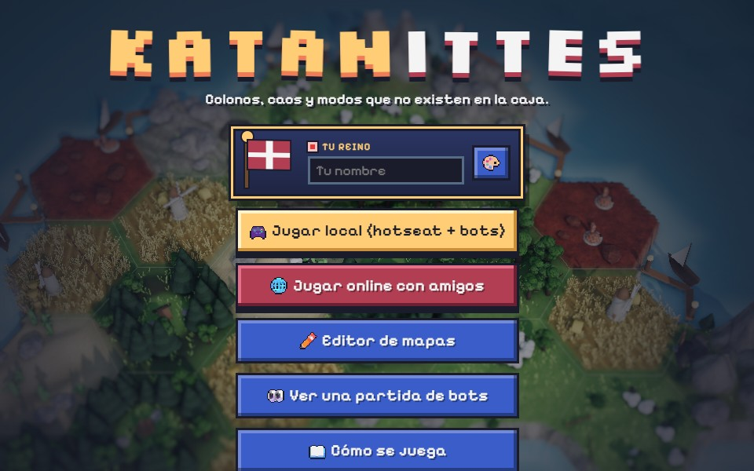
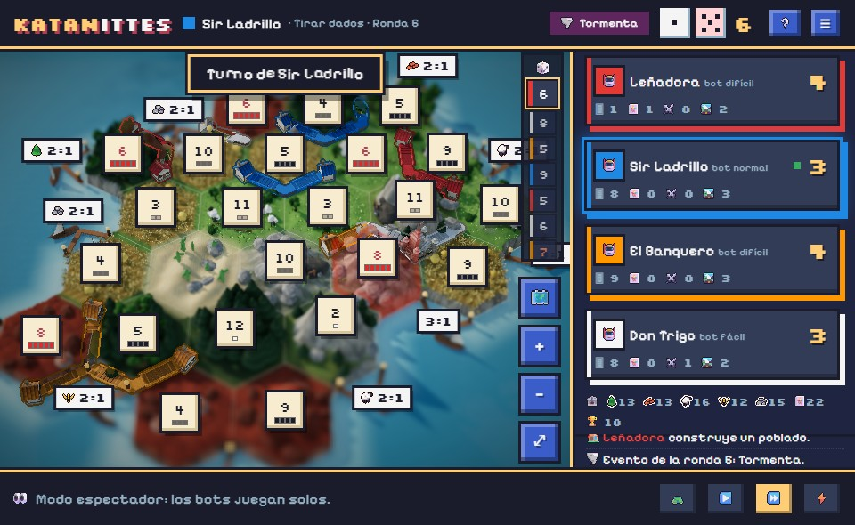

# Katanittes

**Trò chơi khai hoang lấy cảm hứng từ Catan, chơi ngay trên trình duyệt.** Bản đồ tự tạo, những chế độ chơi không có trong hộp, bot chơi rất gắt, chơi online với bạn bè và bàn cờ 3D kiểu sa bàn với giao diện pixel art.

Miễn phí, không quảng cáo, không cần tài khoản, không cần cài đặt. Chạy trên cả máy tính và điện thoại.

| | |
|---|---|
| 🎮 **Chơi ngay** | **https://hex-island.vercel.app** |
| 💻 **Mã nguồn** | https://github.com/phuonglat142/Hex-Island |

---

## Ảnh chụp màn hình

| Menu chính | Một ván đang chơi |
|---|---|
|  |  |

---

## Tính năng

### Bản đồ
- **10 kiểu bản đồ:** cổ điển (19 ô), mini (14), mở rộng cho 5–6 người (30), lớn (37), khổng lồ (61), vòng hồ, ngôi sao, hai vương quốc, quần đảo và lục địa ngẫu nhiên.
- **Trình tạo bản đồ**, chia sẻ bản đồ bằng mã.
- Xếp tài nguyên và số cân bằng hoặc hỗn loạn, có thể thêm **ô vàng**, tùy chỉnh cảng và sa mạc.

### Chế độ đặc sắc
- **Bịt mắt:** cả bàn cờ bị úp từ đầu. Bạn đặt những nhà đầu tiên mà không biết bên dưới là gì (người khác vẫn thấy bạn đặt ở đâu), đặt xong thì cả bàn cờ được lật lên.
- **Sương mù chiến tranh:** mỗi người chỉ thấy quanh công trình của mình và nửa ô hai bên đường. Xây trúng chỗ đã có người mà bạn không thấy thì công trình sẽ dời sang chỗ trống gần nhất.

### Thêm chế độ (kết hợp tùy thích)
- **Nhà bí mật:** không ai thấy người khác đặt nhà đầu ván ở đâu cho tới lúc lật mở; nếu trùng chỗ, người đặt sau phải dời đi.
- **Số bí mật:** bạn thấy tài nguyên, nhưng số chỉ hiện ra khi có người xây sát bên.
- **Sự kiện mỗi vòng:** mỗi vòng rút một sự kiện: được mùa, hạn hán, buôn bán sòng phẳng, chợ đen, động đất, bão, quà của vua, dịch bệnh, thu thuế, nổi dậy hoặc yên bình.
- **Đất chuyển mình:** cứ 3 vòng, số (hoặc tài nguyên) trên bản đồ lại bị xáo trộn.
- **Xúc xắc cân bằng:** kết quả rút từ bộ 36 lá, nên xác suất luôn đúng như lý thuyết.
- **Kẻ trộm hiền lành**, **không có kẻ trộm**, **khởi đầu bằng thành phố** và **tăng tốc** (sản lượng gấp đôi).
- **Bộ cài sẵn** gom các chế độ lại: Cổ điển, Bịt mắt, Sương mù chiến tranh, Nhà thám hiểm, Hoang tưởng, Hỗn loạn, Ván nhanh và Chiến tranh.

### Luật tùy chỉnh được
Điểm chiến thắng, giới hạn thẻ, số lượt đặt đầu ván, quà khởi đầu, số công trình mỗi người, bộ thẻ phát triển (thường, chiến tranh, tiến bộ hoặc không có), vàng, cảng và sa mạc. Có đủ luật gốc: kẻ trộm, bỏ thẻ, cảng 3:1 và 2:1, giao dịch giữa người chơi, thẻ phát triển, con đường dài nhất và đội quân lớn nhất.

### Người chơi
- **Tối đa 8 người**, ngân hàng, bộ thẻ và bản đồ tự điều chỉnh theo.
- Mỗi vương quốc tự vẽ **lá cờ** trên khung pixel 12×12 và chọn **màu lâu đài**; lá cờ tung bay trên bàn cờ 3D.
- **Bot** ba mức (dễ, thường, khó) biết giao dịch, cướp và chặn đường. Có cả nút 💡 gợi ý nước đi.
- **Chơi chung một máy**, có màn hình chuyền máy để giữ bí mật giữa các người chơi.
- **Chế độ xem:** xem các bot đấu với nhau ở tốc độ tùy chọn.

### Chơi online với bạn bè
- **Kết nối ngang hàng** qua WebRTC (PeerJS). Trình duyệt của chủ phòng chạy ván đấu, không cần máy chủ game riêng. Chia sẻ mã phòng ngắn hoặc link.
- **Tự kết nối lại:** rớt mạng thì vẫn quay về đúng ghế.
- Khi có người mất kết nối, cả bàn **bỏ phiếu**: chờ, để bot chơi thay hoặc cho người đó rời ván.
- Nếu chủ phòng rớt mạng, họ có thể **mở lại phòng** với cùng mã và chơi tiếp.
- **Cờ hiệu:** nút chuột giữa cắm một lá cờ nhỏ trên bản đồ cho mọi người cùng thấy.

### Bàn cờ và giao diện
- **Bàn cờ sa bàn 3D** làm bằng three.js: địa hình liền mạch pha trộn 8 texture PBR, bầu trời vật lý với ánh sáng từ ảnh môi trường, nước có bọt theo độ sâu, cỏ và lúa đung đưa trong gió, bóng mây, đổ bóng môi trường và camera hiệu ứng mô hình (tilt-shift).
- **Biến thể ô:** mỗi tài nguyên có nhiều kiểu (đồi thông, bãi đốn gỗ, chuồng cừu tròn, cối xay trên gò, hố đất sét, lò gạch, đỉnh núi tuyết, mỏ đá...), chọn theo từng ô để mọi người thấy cùng một bản đồ.
- Vật trang trí và biểu tượng tài nguyên được dựng trong **Blender** bằng các script ở `tools/blender/` (biểu tượng là mô hình 3D render qua camera pixel).
- Nút **nhìn từ trên xuống:** camera nhìn thẳng xuống bản đồ như bản vẽ phẳng. Ô số và biển cảng thu nhỏ khi bạn zoom ra để không che các ô.
- **Lịch sử tung xúc xắc** ở góc trên bên phải bản đồ: các lần tung gần nhất, mới nhất đứng đầu, theo màu của người tung.
- **Giao diện pixel art** với xúc xắc có thể lấy đà (nhấn giữ nút để tung mạnh hơn), **thẻ bay** từ ô vào tay bạn, giữa các người chơi khi giao dịch, tới và từ ngân hàng, cùng bộ hiệu ứng âm thanh tổng hợp ngay trên trình duyệt.

---

## Kỹ thuật

- **Ngăn xếp:** [Vite 8](https://vite.dev/), TypeScript strict (không còn file JS trong `src/`), [Preact](https://preactjs.com/) + [Signals](https://preactjs.com/guide/v10/signals/) cho giao diện, [three.js](https://threejs.org/) 0.187 cho bàn cờ 3D, [PeerJS](https://peerjs.com/) cho WebRTC, [Comlink](https://github.com/GoogleChromeLabs/comlink) để chạy việc nặng trong Web Worker, mô hình nén meshopt (`gltfpack`), font cài qua [@fontsource](https://fontsource.org/) (Be Vietnam Pro và Baloo 2, có tiếng Việt). Quản lý gói bằng pnpm.
- **Engine luật** (`src/engine/`): hàm thuần. `applyAction(state, action)` kiểm tra và áp dụng mọi nước đi, còn hiệu ứng hình ảnh được trả về dưới dạng danh sách sự kiện, nên cùng một engine chạy ván chơi một máy, ván online (trên máy chủ phòng) và các bài test. Engine không bao giờ import `app/`, `ui/`, `net/` hay `board/` (có script kiểm tra: `pnpm check:imports`).
- **Mức chất lượng của bàn cờ 3D:** Cực đẹp, Cao, Vừa và **Máy yếu**; tự nhận diện theo máy, đổi được trong cài đặt. Mức thấp bỏ hậu kỳ nặng (AO, viền bằng pass), giảm bóng, cỏ, vật trang trí, dùng texture nhỏ và hạ tần số hoạt ảnh nền.
- **Vẽ theo nhu cầu (render-on-demand):** bàn cờ chỉ vẽ lại khi có thay đổi (camera, trạng thái ván, hoạt ảnh đang chạy); khi không ai chạm vào, GPU gần như nghỉ. Địa hình, cỏ và vật trang trí được sinh trong worker; bóng, nhãn và mask chỉ cập nhật khi cần.
- **Online và thông tin ẩn:** chủ phòng giữ trạng thái đầy đủ và gửi cho từng khách một bản đã **lọc** (`redactFor`): không lộ thứ tự bộ thẻ, trạng thái ngẫu nhiên, bài trên tay hay thẻ phát triển của người khác, và các nhà đặt kín. PeerJS chỉ được tải khi vào chơi online.
- **Văn bản:** toàn bộ chữ hiển thị viết thẳng bằng tiếng Việt trong code. Lịch sử ván và thông báo lỗi là chuỗi thường, trong đó `@3` là người chơi số 3 (giao diện thay bằng tên người đó, tô theo màu của họ).

| Phần | File | Chức năng |
|---|---|---|
| Engine luật | `src/engine/` (`game.ts`, `board.ts`, `constants.ts`, `config.ts`, `rng.ts`, `types.ts`) | Trạng thái ván, luật, sinh bản đồ, ngẫu nhiên có seed |
| Bot | `src/engine/bot.ts` | Ba mức độ khó, cộng với nút gợi ý |
| Ứng dụng | `src/app/` (`index.ts`, `store.ts`, `persist.ts`, `events.ts`), `src/main.ts` | Trạng thái ván, gửi hành động, lượt của bot, lưu ván, điểm vào |
| Online | `src/net/` (`host.ts`, `client.ts`, `session.ts`, `redact.ts`, `messages.ts`) | Phòng, đồng bộ do chủ phòng quyết định, lọc thông tin ẩn, kết nối lại, bỏ phiếu |
| Màn hình | `src/ui/screens/` (`Menu`, `Lobby`, `Online`, `Editor`, `Help`) | Menu, sảnh và phòng, trình tạo bản đồ, trợ giúp |
| Màn hình ván | `src/ui/game/` | Thẻ người chơi, bài trên tay, hành động, xúc xắc, giao dịch, thẻ bay |
| Bàn cờ 3D | `src/board/` (`Board3D.ts`, `terrain*.ts`, `pieces.ts`, `fog.ts`, `dice3d.ts`, `quality.ts`...), `src/workers/` | Địa hình, biến thể ô, công trình, sương mù, xúc xắc 3D, mức chất lượng, worker |
| Giao diện chung | `src/ui/components/`, `src/ui/flag/`, `src/ui/pixel.ts`, `sfx.ts`, `dom.ts` | Thành phần dùng chung, cờ, sprite pixel, âm thanh, tiện ích DOM |
| Kiểu dáng | `src/styles/style.css`, `src/styles/pixel.css` | Theme pixel (bảng màu Sweetie-16) |
| Tài nguyên | `public/assets/`, `tools/` (`optimize-assets.mjs`, `source/`, `blender/`) | Texture, mô hình `kit.glb` (nén), biểu tượng, và script tạo ra chúng; xem `docs/assets.md` |
| Script | `scripts/` | `sim`, `determinism`, `baseline`, `check-imports`, `verify-kit`... |
| Test | `tests/` | Test luật, sim bot đấu bot có kiểm tra bất biến, redact, bàn cờ, giao diện, quy ước import |

## Triển khai

Game được host trên **[Vercel](https://vercel.com/)** tại https://hex-island.vercel.app. Mỗi lần đẩy lên `main`, Vercel tự chạy `typecheck`, `test` rồi `build` (cấu hình trong [`vercel.json`](vercel.json)) và xuất bản thư mục `dist/`; nếu typecheck hoặc test lỗi thì bản cũ vẫn giữ nguyên. Các nhánh khác có bản xem trước riêng. File trong `/assets/` được cache lâu dài vì tên đã kèm hash.

## Chạy trên máy

```bash
pnpm install
pnpm dev
# rồi mở địa chỉ Vite in ra (mặc định http://localhost:5173/)
```

Các lệnh khác:

```bash
pnpm test            # vitest: luật, 300 ván bot đấu bot kiểm tra bất biến, redact, giao diện, quy ước import
pnpm typecheck       # tsc --noEmit (TypeScript strict)
pnpm build           # đóng gói bản chạy thật vào dist/
pnpm determinism     # băm kết quả các ván mô phỏng: cùng seed phải ra cùng hash (pnpm determinism 200)
pnpm assets          # sinh lại mô hình nén và texture bản thấp từ tools/source/
pnpm baseline        # đo bundle và thời gian mô phỏng, ghi docs/perf-baseline.md (chạy sau pnpm build)
pnpm check:imports   # engine không import tầng trên, không có vòng import
```

## Giấy phép và ghi công

Code và tài nguyên gốc theo [giấy phép MIT](LICENSE) © 2026 Sowtank. Nếu bạn dùng dự án này hoặc một phần của nó, rất mong bạn ghi công ở chỗ dễ thấy (chi tiết trong [NOTICE.md](NOTICE.md)). Bản thân game cũng hiển thị dòng ghi công đó, kèm link tới kho mã này, ở dưới menu chính và trong màn hình trợ giúp.

**Dự án của người hâm mộ, không chính thức.** Không liên kết, không được tài trợ hay bảo trợ bởi Catan GmbH, CATAN Studio hay Kosmos. *CATAN* là thương hiệu của chủ sở hữu tương ứng. Thông tin bên thứ ba (three.js, PeerJS, Preact, Comlink, font chữ...) nằm trong [NOTICE.md](NOTICE.md).
